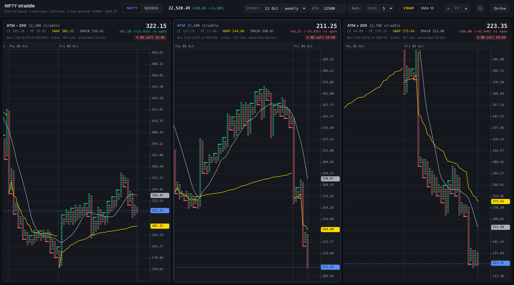
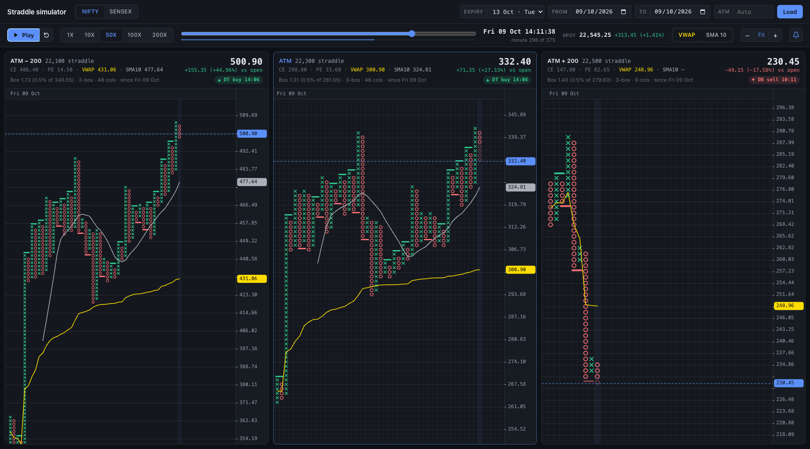

# Neo Straddle PnF

Live Point & Figure charts for NIFTY and SENSEX option straddles, built on the [Kotak Neo trade API](https://github.com/Kotak-Neo/kotak-neo-python).

The screen shows three straddles of the chosen index side by side - ATM - 200, ATM and ATM + 200 for NIFTY (NSE), or ATM - 500, ATM and ATM + 500 for SENSEX (BSE) - each as a Point & Figure chart built from 1-minute closes with a 0.5% box and 3-box reversal.
History comes from the Neo historical API, live prices stream over the Neo WebSocket, and every chart carries the intraday VWAP and a 10-column simple moving average (switch either on or off) plus double top buy / double bottom sell markers, with on-screen and audio alerts when a double bottom sell prints below VWAP.



A separate [simulator](#simulator) replays past sessions on the same charts at 1X to 200X speed.

## Contents

- [Features](#features)
- [How it works](#how-it-works)
- [Requirements](#requirements)
- [Setup](#setup)
- [Running](#running)
- [Using the screen](#using-the-screen)
- [Alerts](#alerts)
- [Data and timing details](#data-and-timing-details)
- [Simulator](#simulator)
- [Development](#development)
- [Security](#security)
- [Limitations](#limitations)

## Features

- **NIFTY or SENSEX:** switch with one click; NIFTY options come from NSE, SENSEX options from BSE.
- **Spot and future:** the index price and the near-month future price, each with its change since the previous close, live in the top bar.
- **Three straddles at once:** ATM and two side strikes (± 200 for NIFTY, ± 500 for SENSEX), laid out horizontally.
- **Point & Figure on 1-minute closes:** box size fixed at 0.5% of the first straddle close in the window, 3-box reversal.
- **ATM from today's open or your own strike:** the default ATM is the index's open rounded to the nearest strike; type any strike to override it.
- **Expiry picker:** upcoming weekly, next weekly, this month's monthly and next month's monthly.
- **History window:** 1 to 15 trading sessions.
- **Live updates:** after a TOTP login on the page, prices stream in and a new 1-minute bar closes every minute; boxes from the minute still forming are drawn faded.
- **VWAP and SMA 10:** the straddle's intraday VWAP (yellow) and a 10-column simple moving average (light black; soft grey in dark mode), each switchable on or off, also shown in each panel header and on the price axis.
- **Signals:** double top buy and double bottom sell are marked on the charts.
  A new double bottom sell with the straddle below its VWAP raises a toast, a panel flash, a chime and (when the tab is in the background) a system notification; double top buys, and sells at or above VWAP, are marked only.
- **Comfortable charts:** hover any box for its price and the time it printed, zoom in and out, scroll through history, light and dark themes.
- **Simulator:** replay past sessions minute by minute at 1X, 10X, 50X, 100X or 200X, with the same charts, overlays and signals, and practise selling the straddles with live P&L (see [Simulator](#simulator)).

## How it works

### Indices

| Index | Options exchange | Strike step | Charts |
| --- | --- | --- | --- |
| NIFTY | NSE (`nse_fo`), index quoted on `nse_cm` as `Nifty 50` | 50 | ATM - 200, ATM, ATM + 200 |
| SENSEX | BSE (`bse_fo`), index quoted on `bse_cm` as `SENSEX` | 100 | ATM - 500, ATM, ATM + 500 |

The NIFTY | SENSEX switch in the top bar changes all three charts.
Each index keeps its own ATM choice; the expiry choice and the number of days apply to both.

### Strikes and expiry

- **ATM:** by default the strike nearest to the day's index open (for example, a NIFTY open of 22,314.95 gives 22,300, and a SENSEX open of 71,776.67 gives 71,800).
  The side charts sit at ATM ± 200 (NIFTY) or ATM ± 500 (SENSEX), and the strikes stay fixed for the whole day.
  At 09:16 on each new trading day the charts rebuild using that day's open.
- **ATM override:** enter any valid strike (a multiple of 50 for NIFTY, 100 for SENSEX) in the ATM box to use it instead.
  The override stays in place for that index, across days and restarts, until you press **Auto**.
- **Expiry:** pick from up to four contracts: the upcoming weekly, the next weekly, this month's monthly and next month's monthly.
  A monthly expiry is the last listed expiry of its calendar month.
  The app remembers which kind of expiry you picked rather than a fixed date, so after a contract expires the choice moves to the next one by itself.
  When a weekly falls on the monthly date it is listed once, as the monthly.

### The straddle series

Each 1-minute straddle close is the CE close plus the PE close for that minute.
Illiquid options can skip minutes, so each leg carries its last close forward, and a chart starts once both legs have traded.
Only regular-session minutes (09:15 to 15:29) are used.

### Point & Figure rules

- **Box size:** 0.5% of the first straddle close in the history window, then fixed for the whole chart.
  The window's dates are fixed for the day (today counts from 09:15), so the box size never changes mid-session.
- **Boxes:** prices are placed on a grid anchored at that first close.
  An X column extends when a close reaches a new box above its top; an O column extends when a close reaches a new box below its bottom.
- **Reversal:** a new column starts only after a move of 3 full boxes against the current column.

### Signals

- **Double top buy:** an X column rises one box above the top of the previous X column.
- **Double bottom sell:** an O column falls one box below the bottom of the previous O column.

Each signal is marked with a solid bar over the previous two columns at the level it broke: a green bar just above the old top for a buy, a red bar just below the old bottom for a sell.
The column that follows the bar is the breakout; hover its first box beyond the bar to see the signal's name.
The latest signal for each chart is shown as a chip in its panel header.

### VWAP (intraday)

The VWAP line is the straddle's intraday VWAP, the standard used by straddle-chart tools (for example AlgoTest's straddle VWAP and Definedge's "Intra VWAP" for Point & Figure charts):

- each minute's straddle price is the CE close plus the PE close (the same prices the chart is built from),
- each minute is weighted by the volume traded in both legs that minute (CE volume + PE volume),
- VWAP = sum of (price x volume) / sum of volume, accumulated from 09:15 and restarted every session.

It is the average price the straddle has actually traded at so far today.
Point & Figure has no time axis, so each column shows the VWAP as it stood when that column last updated, drawn as a line through the column centres and broken where a new session (and a new VWAP) starts.
The newest column updates live, including the minute still forming.

Because Point & Figure compresses time, a busy sideways morning becomes a few columns while a trend prints many, so the VWAP can sit some distance from the most recent columns; that distance is the point of the line (premium above or below its average traded price for the day).

### Simple moving average (SMA 10)

The SMA follows the usual Point & Figure convention: the average of the midpoints of the last 10 columns, where a column's midpoint is halfway between its top and bottom box.
It has one value per column and is drawn as a line through the column centres.
Because it counts columns rather than minutes, it is steady through sideways chop and runs straight across sessions (unlike VWAP, it does not restart each day).
The line starts once a chart has 10 columns, and the newest column's value moves as that column grows.

### Architecture

```
Kotak Neo REST API ──(history, quotes, expiries, scrip search)──┐
                                                               ├─> Python server (FastAPI) ──WebSocket──> Browser
Kotak Neo WebSocket feed ──(live option prices, the index)─────┘    builds 1-min straddle bars          builds P&F, draws charts,
                                                                    and VWAP, pushes updates            detects signals, alerts
```

The server does the data work: picking strikes and expiry, loading and pacing history requests, logging in, turning live ticks into 1-minute bars, and pushing everything to the browser.
The browser builds the Point & Figure charts, detects signals and raises the alerts.

## Requirements

- Python 3.12.
- A Kotak Neo trading account with API access: a consumer key, your registered mobile number, UCC (client code), MPIN, and an authenticator app set up for TOTP.
- Node.js 18+ only if you want to run the JavaScript tests.

## Setup

```sh
git clone https://github.com/karamveer7ue/Neo-Straddle-PnF.git
cd Neo-Straddle-PnF

python3.12 -m venv .venv
.venv/bin/pip install -r requirements.txt

cp .env.sample .env
```

Then edit `.env` with your own credentials:

```ini
CONSUMER_KEY=your-consumer-key
MOBILE_NUMBER=+91XXXXXXXXXX
UCC=YOURUCC
MPIN=123456
```

`.env` is listed in `.gitignore`; never commit it.

## Running

### Starting everything with `start.sh`

The easiest way is to start the live app and the [simulator](#simulator) together, from the project folder:

```sh
./start.sh
```

```text
Live app:  http://127.0.0.1:8765
Simulator: http://127.0.0.1:8766
Press Ctrl+C to stop both.
[live] INFO:     Uvicorn running on http://127.0.0.1:8765 (Press CTRL+C to quit)
[sim]  INFO:     Uvicorn running on http://127.0.0.1:8766 (Press CTRL+C to quit)
```

- **Output:** both servers log to the same terminal, each line tagged `[live]` or `[sim]`.
- **Stopping:** Ctrl+C stops both cleanly; if one of them exits (or crashes), the other is stopped too, so you never end up with half the setup running.
- **Checks first:** it stops with a clear message if the virtualenv (`.venv`) or the `.env` file is missing (see [Setup](#setup)).
- **A server already running:** if something is already listening on a port, `start.sh` names it and asks what to do:

  ```text
  The live app is already running on port 8765 (PID 89522).
  Restarting it ends its session: you will need a fresh TOTP.
  [r]estart or [s]kip?
  ```

  - **r (restart)** stops that server and starts a fresh one with the current code.
    Restarting the live app ends its Neo session, so the page asks for a new TOTP.
  - **s (skip)** leaves it running untouched and starts only the other server; Ctrl+C then stops only the one `start.sh` started.
    If both are skipped, it says "Nothing to start." and exits.
  - Any other answer asks again.
  - Without a terminal to ask (for example, when run from another script), it stops instead of guessing; pass `--restart` or `--skip`.

Options:

| Option | What it does |
| --- | --- |
| `--restart` | Restart servers that are already running, without asking. |
| `--skip` | Leave servers that are already running alone, without asking. |
| `--live-port N` | Port for the live app (default 8765). |
| `--sim-port N` | Port for the simulator (default 8766); must differ from the live app's. |
| `-h`, `--help` | Show the usage. |

```sh
./start.sh --restart                         # e.g. after pulling new code
./start.sh --live-port 9000 --sim-port 9001  # other ports
```

Both servers listen on `127.0.0.1` only (see [Security](#security)).

### Starting the live app on its own

```sh
.venv/bin/python -m pnf              # serves http://127.0.0.1:8765
.venv/bin/python -m pnf --port 9000  # any other port
```

Open the address in a browser.
Charts load from history straight away; this needs only the consumer key, not a login.
Loading takes about 10 to 15 seconds, because history requests are spaced out to stay within the API's rate limits.

**Going live:** live prices need a full Neo session.

- During market hours (09:00 to 15:30 on weekdays) a banner asks for the 6-digit TOTP from your authenticator app.
  Enter it in the top bar; the server logs in with the TOTP plus the MPIN from `.env`, and the status pill turns to **Live**.
- Outside market hours the page shows history only, with a **Go live** button if you want to connect anyway.
- The session lives in the server process, so reloading the page does not ask again.
  Restarting the server, or the session expiring (it lasts for the trading day), means entering a fresh TOTP.

## Using the screen

| Control | What it does |
| --- | --- |
| **NIFTY / SENSEX** | Switches all three charts to the other index. |
| **Spot / Fut** | The index price and the near-month future (e.g. NIFTY26OCTFUT; hover for the contract and expiry), with their change since the previous close. The future rolls to the next month after expiry. |
| **Expiry** | Switches all three charts to another contract. |
| **ATM** | Type a strike (a multiple of 50 for NIFTY, 100 for SENSEX) and press Enter or **Apply**. Esc discards the edit. |
| **Auto** | Goes back to the ATM from today's index open. Hover it to see the open and the strike it gives. |
| **Days** | How many trading sessions of history to show (1 to 15). |
| **VWAP / SMA 10** | Show or hide each overlay on all three charts; both, either or none (remembered by the browser). |
| **- / Fit / +** | Smaller boxes, fit the boxes to the panel height, bigger boxes. |
| **Bell** | Turns alert sounds on or off (remembered by the browser). |
| **Alert log** | Opens the last 30 alerts; the badge counts new ones. |
| **Status pill** | **History only**, **Connecting**, **Reconnecting** or **Live**. |

Inside each panel:

- **Header:** straddle price, change since the session's first close, CE and PE prices, VWAP and SMA 10 (when shown), and the latest signal.
- **Meta line:** box size, reversal, number of columns, and the first session in the window.
- **Chart:** the dashed blue line and blue axis tag mark the current price; the yellow and light-black tags mark the current VWAP and SMA 10; dotted vertical lines separate sessions.
- **Hover:** shows the box's price, the minute it printed, the VWAP and SMA 10 at that column, and the signal name if it is a signal box.
- **Scrolling:** charts follow the newest column automatically; scroll back to browse history, and scroll to the right end to resume following.

## Alerts

Only double bottom sells raise alerts, and only when a closed 1-minute bar confirms the signal with the straddle below its VWAP at that moment (the confirming minute's close against the VWAP then); the alert says where VWAP was.
Double top buys, and double bottom sells at or above VWAP, are still marked on the charts but raise no alert.
They never fire for boxes still forming, and reloading the page does not replay old ones.

Each alert gives you:

- a toast in the bottom-left corner (over the oldest history, so it never hides the latest columns) that closes itself after 12 seconds, with a thin bar counting down; hovering keeps it open, and the alert log keeps the history,
- a pulsing border on the affected panel,
- a chime: rising notes for a buy, falling notes for a sell,
- a system notification when the tab is in the background, if you have allowed notifications (the browser asks when you go live).

**Alert log:** the list button next to the bell opens the last 30 alerts, newest first, with the index, chart, strike, expiry, the level broken, the breakout price and the bar time.
A red badge on the button counts alerts you have not seen yet; opening the log clears it.
The log is kept by the server in `.pnf-alerts.json` (gitignored), so it survives page reloads and server restarts, and an alert seen by several open tabs is logged once.
Alerts are detected in the browser, so they are only logged while at least one page is open.

Browsers block sound until you have interacted with the page, so click anywhere once (entering the TOTP counts).
Until then a toast tells you that sound is waiting for a click.

## Data and timing details

- **Rate limits:** the Neo market-data endpoints reject bursts (HTTP 429), so all REST calls go out one at a time, at least 1.5 seconds apart, and are retried with backoff on 429 and 5xx errors.
- **Today's history:** the historical API may refuse same-day candles while the market is open.
  The app then loads the past sessions and fills today from live bars.
- **Refreshing:** every 5 minutes during the session (and once at 15:36), today's official candles are fetched again and replace the live-built bars they cover.
- **Daily rollover:** at 09:16 on each trading day the charts rebuild with the new day's ATM, expiry and history window.
- **Holidays:** a weekday whose candles load fine but come back empty after 09:30 is treated as a market holiday and left out of the window.
- **Saved settings:** the index on screen, each index's ATM override, the day count and the expiry choice are stored in `.pnf-config.json` (gitignored); the alert log in `.pnf-alerts.json`.

## Simulator

The simulator replays past NIFTY or SENSEX sessions minute by minute on the same three straddle Point & Figure charts as the live page, so you can watch how the straddles, VWAP, SMA 10 and the double top / double bottom signals developed on a day that has already traded.



It is a separate app (`pnf_sim/`), so it never interferes with the live page, and it reuses the live app's code unchanged: the Neo API gateway, the straddle series rules, the Point & Figure engine, VWAP, SMA 10, signal detection, the chart renderer and the alerts.
It reads only market data, so it needs just the consumer key from `.env` and never asks for a TOTP.

### Running the simulator

`./start.sh` starts it together with the live app (see [Starting everything with `start.sh`](#starting-everything-with-startsh)).
To run it on its own:

```sh
.venv/bin/python -m pnf_sim              # http://127.0.0.1:8766
.venv/bin/python -m pnf_sim --port 9001  # any other port
```

It can run at the same time as the live app (port 8765); open each in its own tab.
Setup is the same as for the live app (see [Setup](#setup)); only `CONSUMER_KEY` in `.env` is used.

### Setting up a run

1. Pick **NIFTY** or **SENSEX**.
   Switching index loads that index's expiries first (a second or two); Load waits until they arrive, so a run always uses the index whose button is pressed.
2. Pick an **expiry**: the next four listed expiries.
   NIFTY weeklies expire on Tuesdays and SENSEX weeklies on Thursdays; when the exchange moves an expiry for a holiday, the list shows the actual date (for example, 19 Oct 2026 is a Monday).
3. Pick **From** and **To** dates.
   Both must be before today (the page and the server both check this), a run can cover at most 30 days, and the start can be at most 5 years back (the history API's limit).
4. Optionally type an **ATM** strike (a multiple of 50 for NIFTY, 100 for SENSEX); leave it empty to use the strike nearest to the start day's index open.
5. Press **Load**.
   The history requests are paced to stay within the API's rate limits, so loading takes about 15 seconds.
   While it loads, the previous run is paused and cannot be played; if loading fails, the error is shown and the previous run stays as it was.
   The last 8 runs are kept in memory for the day, so loading one again is instant, even if you reloaded the page while it was being built.
6. Press **Play**.
   Nothing moves until you do, and the panels say so.

### Playback controls

| Control | What it does |
| --- | --- |
| **Play / Pause** | Starts or pauses the replay (keyboard: Space). |
| **Back to the start** | Jumps back to just before the From date's first minute (the clock shows "minute 0"), so the whole run, including its first minute, plays again. |
| **1X / 10X / 50X / 100X / 200X** | Playback speed; hover a button to see how long a full session takes. |
| **Timeline** | Drag to jump to any minute; the left and right arrow keys step exactly one minute (also while the timeline has focus). The thin bar under it shows the time left until the current minute completes. |
| **Clock** | The simulated time, to the second, and the minute count (for example, "minute 296 of 375"). |
| **Spot** | The index at the simulated time, with its change since the previous session's close. |
| **VWAP / SMA 10, zoom, bell** | The same as on the live page; the VWAP/SMA choice is shared with it. |

Speeds:

| Speed | One market minute takes | A full session (375 minutes) takes |
| --- | --- | --- |
| 1X | 60 seconds (real time) | 6 h 15 min |
| 10X | 6 seconds | about 38 min |
| 50X | 1.2 seconds | about 7.5 min |
| 100X | 0.6 seconds | about 3.75 min |
| 200X | 0.3 seconds | about 1.9 min |

Changing speed mid-minute keeps the progress already made towards the next minute, and pausing holds the replay exactly where it is.
The replay keeps its pace in a background tab: when the browser delays its timers, the minutes owed are caught up when the tab runs again.
When the run reaches its end, a "Replay finished" banner appears; it goes away once you drag back or press Back to the start.

Keyboard shortcuts work anywhere on the page except while typing in a field (the date, ATM and expiry inputs keep their keys), and combinations with Alt, Ctrl or Cmd are left to the browser (for example, Alt + Left for Back).

### How a replay works

- **One continuous run:** the trading days between the two dates play back-to-back on one chart, like the live page's multi-day view; weekends and holidays are skipped automatically.
- **Context day:** the trading session just before the From date (weekends and holidays skipped) is already drawn when the run loads, and the replay starts at the From date's first minute.
  The charts therefore start with history, as on the live page: SMA 10 has values from the first minute, signals are judged against the previous day's columns, and the box size comes from the context day's first close.
  VWAP itself restarts at each session's open, so the context day shows its own VWAP line and the From date's VWAP starts fresh at 09:15.
  The context day is not replayed and stays on the chart when you go back along the timeline; if a contract had not traded yet that day, its chart starts at the From date.
- **Strikes** are fixed for the whole run, from the start day's index open (or the ATM you typed): ATM - 200, ATM and ATM + 200 for NIFTY, ATM - 500, ATM and ATM + 500 for SENSEX.
- **Chart rules** are the live page's: box size 0.5% of the first straddle close on the chart (the context day's), 3-box reversal, VWAP restarting at each session's open, SMA 10 of column midpoints.
- **Movement within each minute:** the history API serves 1-minute candles, so each minute plays along its candle's likely path in four steps: open, the two extremes, then the close (a rising candle is taken to dip first, a falling one to rally first).
  The straddle prices, the CE and PE prices, the forming boxes (drawn faded, as on the live page), VWAP and the spot all move during the minute, and the minute's bar is completed at its close.
  For the straddle, the CE and PE paths are added step by step, which approximates the straddle's true path within the minute.
- **Signals and alerts:** double top buy and double bottom sell are marked on the charts.
  As on the live page, only a double bottom sell below VWAP raises an alert (a toast, a panel flash and a chime, labelled "(simulation)"); double top buys are marked only.
  They fire only while playing; dragging along the timeline rebuilds the charts silently, so jumping around never replays old alerts.
  Toasts close themselves after 12 seconds (hover to keep one open), and simulated alerts are never written to the live page's alert log.

### Simulated trades

Each chart has a trade bar at the bottom for practising a short straddle (selling the CE and PE together) while the replay runs.

| Button | What it does |
| --- | --- |
| **Sell 10 lots** | Sells the straddle at the price on screen, including the minute still forming: 650 qty for NIFTY (65 per lot) or 200 qty for SENSEX (20 per lot), using the lot size from the exchange's contract list. One trade at a time per chart, so Sell is hidden while a trade is open. |
| **Exit 50%** | Buys back half of the open lots, rounded down to whole lots (10, 5, 3, 2, 1); disabled when only 1 lot is left. |
| **Exit Full** | Buys back all open lots and closes the trade; Sell appears again. |

- **P&L** updates live in rupees and points: points = entry price - current price (a short straddle gains when the straddle falls), rupees = points x quantity.
  After a partial exit the P&L includes the booked part and the bar shows the lots still open; after a full exit it shows the closed trade's result, plus the total when a chart has been traded more than once.
  Brokerage, taxes and slippage are ignored.
- Buttons work while paused too, at the price on screen.
- Going back along the timeline clears the simulated trades opened (or exited) after the point you go back to, since they have not happened yet; earlier trades and moving forward keep them, and loading a new run starts afresh.
  Signals after that point alert again when they are replayed.

### Which dates can be replayed

- **Only contracts still listed today.** The API cannot fetch option contracts that have expired, so a past day is replayed with one of the next four listed expiries, not with the contract that was nearest on that day.
  For example, on 12 Oct 2026 the 13 Oct weekly can replay the days before it, and so can the monthlies further out.
- **How far back:** a weekly contract usually trades properly for only the last two or three weeks before its expiry (it is thin when first listed); monthlies reach further back.
  If the chosen contract had not started trading on the chosen dates, the simulator says so instead of showing empty charts.
- **At most 30 days per run**, the history API's limit for 1-minute candles, and **at most 5 years back**.
- **Context day:** if the chosen contract had not traded yet on the session before From, the run still loads; that chart simply starts at the From date.

The simulator's own [README](pnf_sim/README.md) has the same details next to its code.

## Development

```sh
.venv/bin/python -m pytest                     # Python tests (live app and simulator)
.venv/bin/python -m pytest tests/test_engine.py::test_live_minute_bars_and_reconcile   # one test
node --test tests/*.test.mjs                   # Point & Figure engine and simulator playback tests
.venv/bin/ruff check && .venv/bin/ruff format --check
```

### Project layout

| Path | Purpose |
| --- | --- |
| `pnf/neo.py` | Async wrapper around the blocking Neo SDK: request pacing, retries, login. |
| `pnf/series.py` | Pure helpers: IST calendar, session filter, straddle series and VWAP, ATM rounding, expiry choices. |
| `pnf/engine.py` | The state machine: building charts, the live feed, minute bars, refreshing, daily rollover. |
| `pnf/app.py` | FastAPI server: the page, `POST /api/login`, `POST /api/config`, and the `/ws` update channel. |
| `pnf/static/pnf.js` | Point & Figure construction and signal detection (the only P&F code). |
| `pnf/static/chart.js` | Canvas chart renderer (draws only the visible area, so long histories stay fast). |
| `pnf/static/axis.js` | Price-axis tag layout, so the price, VWAP and SMA tags never overlap. |
| `pnf/static/alerts.js` | Toasts, sounds and system notifications. |
| `pnf/static/app.js` | Page wiring: controls, server messages, panel headers. |
| `pnf_sim/app.py` | Simulator server: its page, `GET /api/options` (expiries and date limits) and `POST /api/simulate` (builds a run); serves the live app's static files read-only. |
| `pnf_sim/replay.py` | Builds a simulator run: date checks, expiries offered, strikes from the start day's open, straddle series with each minute's price path, previous closes for the spot. |
| `start.sh` | Starts the live app and the simulator together (see [Running](#running)). |
| `pnf_sim/static/` | The simulator page (`simulator.html`, `simulator.js`, `sim.css`), its replay clock (`player.js`) and its simulated trades (`trades.js`). |
| `tests/` | Python tests (the live engine against a fake gateway, and the simulator's run building) and JavaScript tests (the P&F engine and the simulator's replay clock). |

### Testing the live path outside market hours

`tests/test_engine.py` contains a `FakeGateway` and a `tick()` helper that builds feed packets.
`engine.now_ist` is the only clock the engine reads, so you can run the app against the fake gateway with a shifted clock to watch live bars, VWAP and alerts at any time.

## Security

- The server listens on `127.0.0.1` only, because it holds a live trading session; do not expose it to a network.
- Credentials are read from `.env` and are never sent to the browser.
- The TOTP is used once to log in and is not stored.
- The app only reads market data; it never places orders.

## Limitations

- NIFTY and SENSEX only, with fixed side-strike distances (± 200 and ± 500).
- Box size (0.5%), reversal (3 boxes) and the SMA period (10 columns) are fixed in the code (`pnf/static/pnf.js`).
- Alerts work only while the page is open in a browser tab.
- This is a charting tool, not investment advice.
  Check signals against your own analysis before trading.
